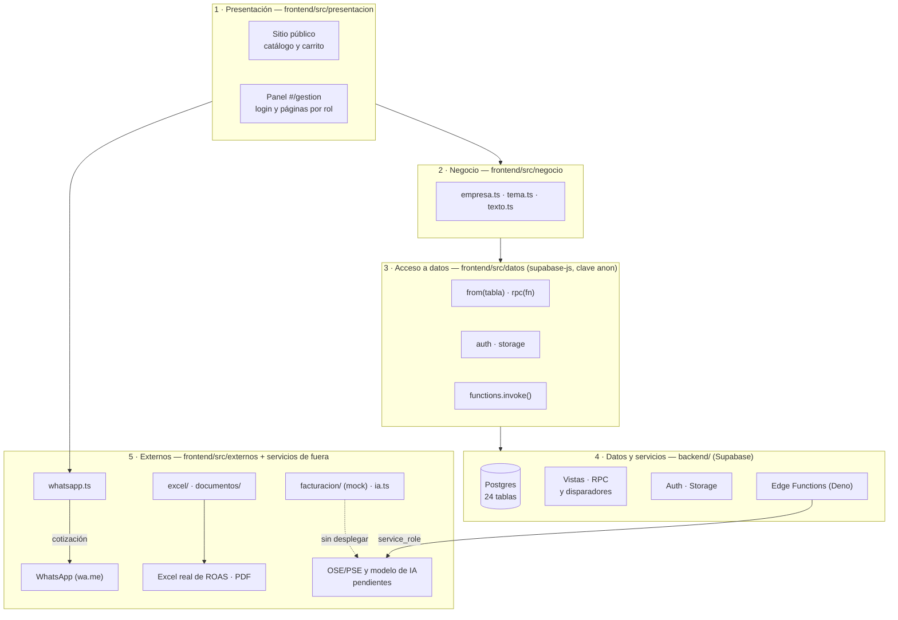

# Documentación del sistema — ROAS Ingenieros Web

Guía completa y en lenguaje simple de **todo** el sistema: qué es, cómo se levanta,
qué hace cada carpeta, qué hace cada archivo, cómo se conecta con Supabase y cómo
se hacen las tareas del día a día (crear una cotización, desplegar una función,
cambiar el Excel de la empresa, etc.).

> Si solo quieres arrancar el proyecto ahora mismo, salta a
> [Cómo levantarlo](#2-cómo-levantarlo-en-3-pasos).

---

## Índice

1. [Resumen en 10 líneas](#1-resumen-en-10-líneas)
2. [Cómo levantarlo en 3 pasos](#2-cómo-levantarlo-en-3-pasos)
3. [Mapa de carpetas](#3-mapa-de-carpetas)
4. [Arquitectura: cómo encajan las piezas](#4-arquitectura-cómo-encajan-las-piezas)
5. [El sitio público (la web que ve el cliente)](#5-el-sitio-público-la-web-que-ve-el-cliente)
6. [El panel de gestión (el ERP interno)](#6-el-panel-de-gestión-el-erp-interno)
7. [La capa de datos (Supabase)](#7-la-capa-de-datos-supabase)
8. [Edge Functions (el backend, en `backend/supabase/`)](#8-edge-functions-el-backend-en-backendsupabase)
9. [Documentos: cotización en Excel e impresión/PDF](#9-documentos-cotización-en-excel-e-impresiónpdf)
10. [Facturación SUNAT y el “modo prueba”](#10-facturación-sunat-y-el-modo-prueba)
11. [La IA del panel (asistente)](#11-la-ia-del-panel-asistente)
12. [Tema claro / oscuro](#12-tema-claro--oscuro)
13. [Recetas: “¿cómo hago…?”](#13-recetas-cómo-hago)
14. [Pruebas y verificaciones](#14-pruebas-y-verificaciones)
15. [Problemas comunes y su solución](#15-problemas-comunes-y-su-solución)
16. [Convenciones del código](#16-convenciones-del-código)
17. [Estado actual y pendientes](#17-estado-actual-y-pendientes)

---

## 1. Resumen en 10 líneas

- Es **una sola aplicación web** (React + TypeScript + Vite) que contiene **dos
  productos distintos**:
  - el **sitio público** (catálogo de productos/servicios que termina en WhatsApp), y
  - el **panel de gestión** (ERP interno: cotizaciones, ventas, comprobantes, guías,
    garantías, compras, personal, inventario, reportes, usuarios y auditoría).
- Ambos viven en el mismo bundle pero **nunca se muestran a la vez**:
  `#/gestion...` abre el panel; cualquier otra URL muestra el sitio público.
- Los datos viven en **Supabase** (Postgres + Auth + Storage + Edge Functions).
- El navegador solo usa la **clave pública (`anon`)**; las operaciones sensibles
  (crear usuarios) pasan por una **Edge Function** que usa `service_role` en el servidor.
- Los documentos de la empresa (cotización) se generan rellenando **el Excel real
  de ROAS** (`frontend/public/plantillas/cotizacion.xlsx`) y también se pueden imprimir en PDF.
- La facturación electrónica está **simulada** (modo prueba) hasta que se elija el OSE/PSE.
- Hay un **asistente de IA opcional** con reglas locales de respaldo (nunca bloquea el trabajo).

---

## 2. Cómo levantarlo en 3 pasos

**Requisito:** Node.js 18 o superior (`node -v`) y npm.

```bash
# 1. Instala las dependencias (solo la primera vez)
npm install

# 2. Crea el archivo .env en la raíz con las claves de Supabase
#    (pídelas en Supabase → Project Settings → API)
#    VITE_SUPABASE_URL=https://<tu-proyecto>.supabase.co
#    VITE_SUPABASE_ANON_KEY=<tu-clave-anon>

# 3. Levanta el servidor de desarrollo
npm run dev
```

Luego abre:

| URL | Qué se abre |
|---|---|
| `http://localhost:5173/` | Sitio público (catálogo) |
| `http://localhost:5173/#/gestion` | Panel de gestión (pide login) |

### Comandos disponibles

| Comando | Para qué sirve |
|---|---|
| `npm run dev` | Servidor de desarrollo con recarga en caliente |
| `npm run build` | Comprueba tipos (`tsc -b`) y genera la carpeta `dist/` lista para publicar |
| `npm run preview` | Sirve `dist/` localmente, para revisar el build |
| `npm run lint` | Revisa el código con ESLint (incluye `backend/supabase/functions/**`) |
| `npm run plantilla:cotizacion` | Regenera la plantilla Excel desde el Excel de la empresa |
| `npm run probar:plantillas` | Prueba el motor de plantillas (ida y vuelta del `.xlsx`) |
| `npx playwright test` | Pruebas visuales en navegador (ver [sección 14](#14-pruebas-y-verificaciones)) |
| `npx supabase functions deploy <nombre>` | Publica una Edge Function (se corre **desde `backend/`**; ver [sección 8](#8-edge-functions-el-backend-en-backendsupabase)) |

> **Importante:** `node_modules/` no viene en el ZIP ni en el repositorio. Si ves
> *"vite no se reconoce como un comando interno o externo"*, es porque falta
> `npm install`. Ver [problemas comunes](#15-problemas-comunes-y-su-solución).

---

## 3. Mapa de carpetas

```
ROASingenieros-Web-main/
├── frontend/                   La app React (interfaz + lógica que corre en el navegador)
│   ├── index.html                  Página base: título/SEO, fuentes y <div id="root">
│   ├── public/                     Archivos servidos tal cual (sin procesar)
│   │   ├── plantillas/cotizacion.xlsx   Plantilla de cotización con marcas {{...}}
│   │   └── documentos/                  Logos del membrete (PNG extraídos del Excel)
│   └── src/                        El código, separado por capas (ver abajo)
│
├── backend/                    Lo que corre en Supabase
│   └── supabase/
│       ├── config.toml              Configuración del proyecto Supabase
│       ├── .gitignore               Ignora .temp y .branches
│       └── functions/usuarios/index.ts  Edge Function que crea usuarios
│
├── docs/
│   └── DOCUMENTACION.md        Este documento
├── scripts/                    Scripts de Node que se corren con npm run
│   ├── plantilla-cotizacion.mjs     Adapta el Excel de la empresa → frontend/public/
│   └── probar-plantillas.mjs        Prueba automática del motor de plantillas
├── tests/                      Pruebas de Playwright + capturas de pantalla
├── dist/                       Salida del build (generado; no se edita a mano)
│
├── package.json                Dependencias y comandos (scripts)
├── vite.config.ts              Configuración del empaquetador (`root: frontend/`)
├── playwright.config.ts        Configuración de pruebas en navegador
├── tsconfig*.json              Configuración de TypeScript (app y node)
├── eslint.config.js            Reglas de estilo del código
└── .env                        Claves de Supabase  (¡no se sube al repo!)
```

Los comandos se siguen corriendo **desde la raíz** (`npm run dev`, `npm run build`,
`npm run lint`): `vite.config.ts` apunta a `frontend/` y el `.env` se lee de la raíz.
Lo único que cambia de sitio son los comandos de la **CLI de Supabase**, que ahora se
corren desde `backend/` (ver [8.2](#82-desplegar-o-volver-a-desplegar-una-edge-function)).

### Dentro de `frontend/src/` (las capas que corren en el navegador)

| Carpeta / archivo | Capa | Qué contiene |
|---|---|---|
| `main.tsx` | 1 | Punto de entrada: aplica el tema y monta React |
| `App.tsx` | 1 | Decide entre **sitio público** y **panel** según la URL (`#/gestion`) |
| `index.css` · `App.css` | 1 | Variables de color (temas claro/oscuro), estilos globales y del sitio |
| `presentacion/publico/` | 1 | El sitio público: `componentes/`, `contexto/` (carrito) y `hooks/` |
| `presentacion/gestion/` | 1 | **Todo el panel**: login, menú, router, componentes UI y las páginas |
| `negocio/` | 2 | Las reglas sin interfaz: `empresa.ts`, `tema.ts`, `texto.ts` |
| `datos/` | 3 | La frontera con Supabase: el cliente y los tipos de las tablas |
| `externos/` | 5 | Los adaptadores a los servicios de fuera: WhatsApp, Excel/PDF, OSE-PSE (simulado) e IA |
| `assets/` | — | Imágenes que importa el código (logo del encabezado, hero) |

### Dentro de `presentacion/publico/` (el sitio que ve el cliente)

| Archivo | Responsabilidad |
|---|---|
| `componentes/` | Secciones del sitio (Header, Hero, Servicios, Catálogo, Carrito, Contacto, Footer…) y sus `.css` |
| `contexto/` | Carrito de cotización del sitio público (estado global) |
| `hooks/` | Hooks reutilizables (tema, parallax, revelado al hacer scroll) |

### Dentro de `negocio/` (las reglas, sin interfaz)

| Archivo | Responsabilidad |
|---|---|
| `empresa.ts` | Datos del emisor (razón social, RUC, dirección, cuentas de pago). **Fuente única** para documentos |
| `tema.ts` | Leer/aplicar el tema claro/oscuro por ámbito (sitio / panel) |
| `texto.ts` | Reglas de texto compartidas: correo válido (`esCorreoValido`) y MAYÚSCULAS de los reportes (`enMayusculas`) |

### Dentro de `externos/` (los adaptadores, capa 5)

| Archivo | Responsabilidad |
|---|---|
| `whatsapp.ts` | Arma el mensaje de la cotización y abre `wa.me` |
| `excel/plantilla.ts` | Motor de plantillas Excel: abre el `.xlsx`, reemplaza `{{...}}` y descarga |
| `excel/documentos.ts` | Traduce datos de la base a las marcas de la plantilla de cotización |
| `documentos/cotizacion-html.ts` | La misma cotización en HTML, para imprimir / guardar como PDF |
| `facturacion/index.ts` | Interfaz del proveedor de facturación + implementación simulada (mock) |
| `ia.ts` | Asistente: auditoría fiscal previa y resumen de tendencias (con reglas locales de respaldo) |

### Dentro de `datos/` (la única salida del navegador)

| Archivo | Responsabilidad |
|---|---|
| `supabase.ts` | Cliente de Supabase (clave **anon**), **tipos de las tablas** y ayudas (`formatoSoles`, `formatoFecha`, `mensajeErrorBD`, `registrarSolicitudWeb`) |
| `supabase-schema.sql` | ⚠️ Esquema **antiguo** (en inglés: `products`, `categories`). **No** corresponde a la app actual; ver [nota](#71-la-base-de-datos-no-está-en-el-repo) |

### Dentro de `presentacion/gestion/` (el panel)

| Archivo | Responsabilidad |
|---|---|
| `GestionApp.tsx` | Menú por rol, protección de rutas y armazón (sidebar + contenido) |
| `router.ts` | Router por hash: `#/gestion/<pagina>[/<id>]` |
| `AuthContext.tsx` / `AuthGestionProvider.tsx` | Sesión, perfil y permisos (`puede('admin', …)`) |
| `ui.tsx` | Componentes compartidos: `Pagina`, `Modal`, `Boton`, `Campo`, `Aviso`, `Badge`, `Cargando`, `Vacio` |
| `imprimir.ts` | Abre una ventana limpia y manda a imprimir (o guardar como PDF) |
| `gestion.css` | Todos los estilos del panel |
| `componentes/Graficos.tsx` | Gráficos del panel (tendencia de ventas, pipeline, top productos) |
| `paginas/*.tsx` | Una página por módulo del menú |

---

## 4. Arquitectura: cómo encajan las piezas

### 4.1 Diagrama de capas

El sistema tiene **cinco capas**: las tres primeras viven en el navegador (cada una
solo habla con la de abajo), la cuarta es Supabase y la quinta son los servicios y
artefactos de fuera.



**Cómo leerlo**

| Capa | Qué contiene |
|---|---|
| 1 · Presentación | `frontend/src/presentacion`: sitio público (`publico/componentes/`, `publico/contexto/` para el carrito) y panel (`gestion/GestionApp.tsx`, `router.ts`, `ui.tsx`, `paginas/*.tsx`) |
| 2 · Negocio | `frontend/src/negocio`: reglas sin interfaz — `empresa.ts` (datos del emisor), `tema.ts` (claro/oscuro) y `texto.ts` (correo válido y mayúsculas de reportes) |
| 3 · Acceso a datos | `frontend/src/datos/supabase.ts`: el cliente con la clave **anon**, sus tipos de tabla, `formatoSoles` / `formatoFecha` / `mensajeErrorBD` y los cinco verbos (`from`, `rpc`, `auth`, `storage`, `functions`) |
| 4 · Datos y servicios | **Postgres** (24 tablas), **vistas** (`v_stock_bajo`, `v_ventas_mensual`, `v_margen_producto`), **RPC y disparadores**, **Auth**, **Storage** (`productos`) y las **Edge Functions** (`usuarios`, `asistente`, `facturacion`) |
| 5 · Externos | Los **adaptadores** de `frontend/src/externos/` (`whatsapp.ts`, `excel/`, `documentos/`, `facturacion/`, `ia.ts`) y lo que hay fuera: WhatsApp (`wa.me`), el Excel real de ROAS y el PDF del navegador, más los dos pendientes (el OSE/PSE y el modelo de IA) |

Cinco reglas que el diagrama deja a la vista:

- **Cada capa solo conoce a la de abajo.** Una página del panel no escribe SQL: pide
  a `frontend/src/negocio` (capa 2), y `frontend/src/negocio` habla con el cliente de `supabase.ts` (capa 3).
- **La capa 3 es la única frontera de salida del navegador.** Siempre con la clave
  **anon** (pública) y bajo las políticas **RLS** de Postgres.
- **La `service_role` nunca sale del servidor:** solo la usan las Edge Functions
  (capa 4), que es la flecha marcada *service_role*.
- **Los documentos no pasan por un servidor de reportes:** salen de los adaptadores
  (`externos/excel/` y `externos/documentos/`) hacia los externos (ExcelJS para el
  `.xlsx` y la ventana de impresión para el PDF). El carrito (capa 1) usa
  `publico/contexto/` para el estado y `externos/whatsapp.ts` para armar el mensaje
  hacia `wa.me`.
- **La línea punteada es degradación controlada:** si las Edge Functions `asistente`
  o `facturacion` no están desplegadas, `externos/ia.ts` responde con sus reglas
  locales y `FacturacionMock` (`externos/facturacion/`) simula la emisión. Nada se
  bloquea; solo se avisa en pantalla.

### 4.2 Reglas de oro del diseño

1. **Una sola app, dos experiencias.** `App.tsx` mira el hash de la URL: si empieza
   con `#/gestion` monta el panel; si no, el sitio público.
2. **El navegador nunca ve `service_role`.** Lo único que no se puede hacer con la
   clave pública (crear usuarios) pasa por una Edge Function.
3. **Los números los calcula la base.** Subtotal, IGV y total vienen calculados de
   Postgres (y los documentos solo los escriben). El IGV es **18 %**.
4. **Nada bloquea el trabajo por un servicio opcional.** Si la IA o la facturación
   no están disponibles, hay respaldo local (reglas o simulación) y se avisa en pantalla.
5. **Los documentos se generan en el navegador** (ExcelJS) o en una ventana de
   impresión: no dependen de un servidor de reportes.

---

## 5. El sitio público (la web que ve el cliente)

**Entrada:** `frontend/index.html` (raíz de Vite) → `frontend/src/main.tsx` →
`frontend/src/App.tsx` → `PublicSite`.

### Pantallas

No hay router: `App.tsx` guarda la pantalla activa en estado y anima la transición
(`PageTransition`). Las pantallas son:

| Pantalla | Componente | Qué hace |
|---|---|---|
| Inicio | `publico/componentes/Hero.tsx` | Presentación de la empresa, llamada a la acción |
| Servicios | `publico/componentes/Services.tsx` | Líneas de negocio (electricidad, seguridad, pozos, torres) |
| Productos | `publico/componentes/ProductCatalog.tsx` | Catálogo leído de Supabase y carrito de cotización |
| Contacto | `publico/componentes/Contact.tsx` | Formulario que arma un mensaje de WhatsApp |

### El carrito de cotización

| Archivo | Rol |
|---|---|
| `publico/contexto/CartContext.tsx` | Define el contexto y `useCart()` |
| `publico/contexto/CartProvider.tsx` | Guarda el carrito, calcula totales y muestra avisos |
| `publico/componentes/CartDrawer.tsx` | Ventana del carrito: cantidades, nombre y celular del cliente |
| `publico/componentes/CartToast.tsx` | Aviso emergente (“Producto añadido ✓”) |
| `App.tsx` (`FloatingCartButton`) | Botón flotante con el número de ítems |
| `utils/whatsapp.ts` | Arma el texto y abre `https://wa.me/51932101907` |

**Qué pasa al pulsar “Cotizar por WhatsApp”:**
1. Se valida que haya **nombre** y un **celular de 9 dígitos**.
2. Se llama a `registrarSolicitudWeb(...)` (`datos/supabase.ts`), que guarda el lead en
   la tabla `auditoria` (con `tabla = 'solicitud_web'`) usando la RPC
   `registrar_solicitud_web`. **Si falla, no se interrumpe nada**: solo se avisa en
   la consola. Esto alimenta “Solicitudes web” en el panel.
3. Se abre WhatsApp con el detalle de los ítems ya escrito.

### De dónde salen los productos del catálogo

`ProductCatalog.tsx` consulta `productos` con estos filtros:

```ts
.eq('activo', true)
.eq('visible_web', true)
.eq('tipo', 'producto')     // los servicios no se listan como producto
.gt('stock_actual', 0)      // sin stock no se ofrece
```

Si faltan las variables `VITE_SUPABASE_URL` / `VITE_SUPABASE_ANON_KEY`, la pantalla
muestra un aviso de “Supabase no configurado” en lugar del catálogo.

### Detalles de presentación

- Iconos: `lucide-react`. Fuentes: Inter + Plus Jakarta Sans (desde Google Fonts).
- Animaciones: `Reveal` / `StaggerReveal` (aparecer al hacer scroll), `ParallaxSection`,
  `HeroParticles`, `PageTransition`.
- `WhatsAppFloat`: botón flotante con atajos (“Cotizar electricidad”, etc.).

---

## 6. El panel de gestión (el ERP interno)

**Entrada:** `#/gestion` → `App.tsx` → `presentacion/gestion/GestionApp.tsx`.

### 6.1 Sesión y permisos

| Paso | Qué ocurre |
|---|---|
| 1 | `AuthGestionProvider` pide la sesión a Supabase (`supabase.auth.getSession()`) |
| 2 | Con el `user.id` lee su fila en **`perfiles`** (`id, nombre, rol, activo, creado_en`) |
| 3 | Si **no hay perfil** o **`activo = false`**, el usuario no entra: se muestra `Login` |
| 4 | Si entra, `puede('admin', 'supervisor')` decide qué ve y qué puede hacer |

- Un usuario nuevo se crea **desde “Usuarios y roles”** (Edge Function `usuarios`).
- Para salir: botón “Cerrar sesión” (llama a `salir()` y limpia el hash).
- “¿Olvidaste tu contraseña?” usa `resetPasswordForEmail` con retorno a `#/gestion`.

### 6.2 Roles y menú

Tres roles: `admin` (Gerente), `supervisor`, `secretaria`. El menú se arma en
`GestionApp.tsx` (`MENU`) y **cada ruta vuelve a comprobar el rol** en `RutaPagina`.
Si no corresponde, aparece “No tienes permiso para esta sección”.

| Grupo | Página | Ruta | admin | supervisor | secretaria |
|---|---|---|---|---|---|
| Operación diaria | Panel | `panel` | ✅ | ✅ | — |
| | Clientes | `clientes` | ✅ | ✅ | ✅ |
| | Cotizaciones | `cotizaciones` | ✅ | ✅ | ✅ |
| | Solicitudes web | `solicitudes` | ✅ | — | — |
| | Órdenes de venta | `ventas` | ✅ | ✅ | ✅ |
| | Comprobantes | `comprobantes` | ✅ | ✅ | ✅ |
| | Guías de remisión | `guias` | ✅ | ✅ | ✅ |
| | Garantías | `garantias` | ✅ | ✅ | ✅ |
| Catálogo e inventario | Productos y servicios | `productos` | ✅ | ✅ | ✅ |
| | Categorías / marcas | `catalogo` | ✅ | ✅ | ✅ |
| | Inventario | `inventario` | ✅ | ✅ | ✅ |
| Gerencia | Compras a proveedor | `compras` | ✅ | — | — |
| | Personal y pagos | `personal` | ✅ | — | — |
| | Reportes | `reportes` | ✅ | ✅ | — |
| | Usuarios y roles | `usuarios` | ✅ | — | — |
| | Auditoría | `auditoria` | ✅ | — | — |

Además hay permisos “finos” dentro de cada pantalla, por ejemplo:
- Inventario: solo `admin` y `supervisor` pueden **ajustar stock**.
- Órdenes de venta: solo `admin` y `supervisor` **confirman/anulan**.
- Cotizaciones: **convertir en venta** solo `admin` y `supervisor`.
- Comprobantes: los tres roles crean el borrador, pero **verificar y emitir** solo
  `admin` y `supervisor`.
- Top de márgenes en el Panel: solo `admin`.

### 6.3 El router por hash

`presentacion/gestion/router.ts` es un mini-router sin dependencias:

```ts
rutaActual()        // lee el hash actual
irA('clientes')     // navega a #/gestion/clientes
useRutaGestion()    // devuelve [pagina, id]   → id para pantallas de detalle
useIrA()            // devuelve la función irA
```

Ejemplo: `#/gestion/cotizaciones/42` abre la página `Cotizaciones` con `id = "42"`.

### 6.4 Qué hace cada página

| Página | Qué hace | Tablas / RPC que usa |
|---|---|---|
| `Panel.tsx` | KPIs (ventas sin IGV, cotizaciones, ticket promedio, stock bajo, garantías por vencer, solicitudes), gráficos y accesos rápidos. Periodo semanal o mensual | `cotizaciones`, `ventas`, `auditoria` (`tabla='solicitud_web'`), `garantias`, `v_stock_bajo`, `v_margen_producto`, `v_ventas_mensual` |
| `Clientes.tsx` | Alta/edición de clientes, búsqueda e **historial** (cotizaciones y ventas del cliente) | `clientes`, `tipo_documento`, `ubicacion` |
| `Cotizaciones.tsx` | Crear cotización con ítems, cambiar estado, **imprimir/PDF**, **descargar Excel** y **convertir en venta** (solo si está *aprobada* y el rol es admin/supervisor) | `cotizaciones`, `detalle_cotizacion`, `productos`, RPC `convertir_cotizacion_a_venta` |
| `Solicitudes.tsx` | Bandeja de leads del catálogo (solo Gerente): escribir por WhatsApp, **crear cotización**, descartar | `auditoria` (`tabla='solicitud_web'`), `clientes`, `productos`, `cotizaciones`, `detalle_cotizacion` |
| `Ventas.tsx` | Órdenes de venta: ver detalle, **confirmar** (descuenta stock) y **anular** (lo repone) | `ventas`, `detalle_venta` |
| `Comprobantes.tsx` | Boleta/factura desde una venta: crear borrador, verificar, **emitir** (con auditoría fiscal previa) y anular | `comprobantes`, `ventas`, `detalle_venta`, RPC `crear_comprobante` |
| `Guias.tsx` | Guías de remisión desde una venta; al emitir guarda la respuesta y permite imprimir | `guias_remision`, `ventas`, RPC `crear_guia_remision` |
| `Garantias.tsx` | Registra garantías por ítem vendido y avisa de las que vencen en 30 días | `garantias`, `detalle_venta` |
| `Productos.tsx` | Productos y servicios: precios, stock, visibilidad web, **subida de imagen** al bucket `productos`, costo (solo Gerente) | `productos`, `producto_costo`, `categoria`, `marca`, `modelo`, Storage, RPC `ajustar_stock` |
| `Catalogo.tsx` | Mantenimiento de **categorías, marcas, modelos, tipos de documento y ubicaciones** | `categoria`, `marca`, `modelo`, `tipo_documento`, `ubicacion` |
| `Inventario.tsx` | Stock crítico (`v_stock_bajo`), historial de movimientos y **ajuste manual** con motivo | `movimientos_inventario`, `v_stock_bajo`, `productos`, RPC `ajustar_stock` |
| `Compras.tsx` | Proveedores y órdenes de compra (con detalle); cambio de estado de la orden | `proveedores`, `ordenes_compra`, `detalle_compra`, `productos` |
| `Personal.tsx` | Empleados, cargos y pagos de personal | `empleados`, `cargo`, `pagos_personal`, `perfiles` |
| `Reportes.tsx` | Reporte semanal/mensual de ventas confirmadas: **Excel**, **PDF** y **resumen IA** de tendencias | `ventas`, `v_ventas_mensual` |
| `Usuarios.tsx` | Lista de usuarios (`listar_usuarios`), cambiar rol, activar/desactivar y **invitar** | RPC `listar_usuarios`, `perfiles`, Edge Function `usuarios` |
| `Auditoria.tsx` | Quién cambió qué, con valor anterior y nuevo (solo Gerente) | `auditoria` |

### 6.5 El flujo comercial completo (el camino feliz)

```
Cliente web                         (opcional) Solicitudes web
   │  carrito → WhatsApp                       │ “Crear cotización”
   ▼                                           ▼
                    COTIZACIÓN  (borrador → enviada → aprobada)
                                   │ “Convertir en venta”
                                   ▼
                    ORDEN DE VENTA  (pendiente)
                                   │ “Confirmar”
                                   ▼
                    VENTA CONFIRMADA  ← aquí baja el stock (movimiento de inventario)
                          │                  │                    │
                          ▼                  ▼                    ▼
                 COMPROBANTE          GUÍA DE REMISIÓN       GARANTÍAS
                (borrador→verificado→emitido)   (emitida)      (por ítem vendido)
```

Reglas asociadas:
- Solo una cotización **aprobada** se puede convertir en venta.
- Confirmar la venta descuenta stock; anularla lo repone (lo hace la base).
- Los comprobantes se emiten **después** de la venta confirmada (hay una auditoría
  fiscal previa que solo sugiere, no bloquea).
- **Comprobantes:** a una venta le corresponde **un** comprobante; el selector solo
  ofrece ventas que aún no tienen ninguno.
- **Guías:** el selector lista todas las ventas **no anuladas** (una venta puede
  llevar más de una guía, p. ej. si el traslado se hace en partes).

---

## 7. La capa de datos (Supabase)

### 7.1 La base de datos **no** está en el repo

Las tablas, vistas, RPC, disparadores y políticas **viven en tu proyecto de
Supabase**. Este repositorio solo contiene el cliente que las usa. Consecuencia
práctica: si clonas el código en una base nueva y vacía, la app **fallará** hasta
que apliques el esquema en esa base.

> ⚠️ `frontend/src/datos/supabase-schema.sql` es un **esquema antiguo en inglés**
> (`categories`, `products`, `admin_profiles`) que **no** corresponde a la
> aplicación actual (en español). No lo ejecutes pensando que arregla algo: sirve
> solo como referencia histórica. El esquema vigente se administra desde el
> **SQL Editor** del panel de Supabase.

### 7.2 Tablas que usa el panel

`clientes`, `tipo_documento`, `ubicacion`, `categoria`, `marca`, `modelo`,
`productos`, `producto_costo`, `movimientos_inventario`, `cotizaciones`,
`detalle_cotizacion`, `ventas`, `detalle_venta`, `comprobantes`, `guias_remision`,
`garantias`, `proveedores`, `ordenes_compra`, `detalle_compra`, `empleados`,
`cargo`, `pagos_personal`, `perfiles`, `auditoria`.

Campos clave que conviene recordar:

| Tabla | Campos importantes |
|---|---|
| `productos` | `tipo` (`producto`/`servicio`), `precio_unitario` **sin IGV**, `stock_actual`, `stock_minimo`, `visible_web`, `activo`, `unidad_medida` |
| `perfiles` | `id` (= id del usuario de Auth), `nombre`, `rol`, `activo`, `creado_en` |
| `cotizaciones` | `num_cotizacion`, `estado`, `subtotal`, `igv`, `total`, `asunto`, `forma_pago`, `notas`, `origen` |
| `ventas` | `num_venta`, `estado` (`pendiente`/`confirmada`/`anulada`), `id_cotizacion`, `subtotal/igv/total` |
| `comprobantes` | `serie`, `correlativo`, `estado`, `hash_cpe`, `pdf_url`, `xml_url`, `respuesta_sunat` |
| `auditoria` | `tabla`, `operacion`, `valor_anterior`, `valor_nuevo`, `id_usuario`, `creado_en` |

### 7.3 Vistas (consultas ya preparadas)

| Vista | Para qué |
|---|---|
| `v_stock_bajo` | Productos con `stock_actual` por debajo del mínimo (alertas del Panel e Inventario) |
| `v_ventas_mensual` | Ventas agregadas por mes (`mes`, `n_ventas`, `ventas_sin_igv`) para el gráfico y la IA |
| `v_margen_producto` | Ingreso, ganancia y % de ganancia por producto (Top de márgenes, solo Gerente) |

### 7.4 RPC (funciones SQL que llama la app)

| RPC | Parámetros | Para qué |
|---|---|---|
| `listar_usuarios` | — | Devuelve usuarios con correo y último acceso (une `perfiles` con `auth.users`) |
| `ajustar_stock` | `p_id_producto`, `p_nuevo_stock`, `p_motivo` | Fija el stock y deja el movimiento `ajuste` en el historial |
| `convertir_cotizacion_a_venta` | `p_id_cotizacion`, `p_oc_cliente` | Crea la orden de venta a partir de la cotización (copia ítems) |
| `crear_comprobante` | `p_id_venta`, `p_tipo` | Crea el borrador con serie y correlativo correctos |
| `crear_guia_remision` | `p_id_venta`, `p_punto_partida`, `p_punto_llegada`, `p_fecha_traslado` | Crea la guía de remisión |
| `registrar_solicitud_web` | `p_nombre`, `p_telefono`, `p_items` | Guarda el lead del catálogo en `auditoria` (SECURITY DEFINER) |

**Las RPC son la forma recomendada de escribir** cuando hay numeración, validaciones o
varias tablas de por medio: así el navegador no puede “romper” la secuencia.

### 7.5 Auditoría

La tabla `auditoria` guarda `tabla`, `operacion`, `valor_anterior`, `valor_nuevo`,
`id_usuario` y `creado_en`. El panel **solo la lee** (`Auditoria.tsx`) y la usa para
la bandeja de Solicitudes web. El llenado automático (disparadores en Postgres)
también vive en la base, no en este repo.

### 7.6 Storage

Bucket público **`productos`**: `Productos.tsx` sube la imagen con
`supabase.storage.from('productos').upload(...)` y guarda la URL pública en
`productos.imagen_url`. Si el bucket no existe, el panel avisa y permite pegar una
URL a mano.

### 7.7 Seguridad (RLS)

- Todo el trabajo del panel se hace con la sesión del usuario → las políticas RLS de
  Postgres son las que realmente autorizan.
- El panel muestra/oculta según el rol, pero **eso es comodidad, no seguridad**: si
  alguien manipulase el navegador, la base seguiría aplicando RLS.
- La única operación que necesita `service_role` (crear usuarios) se hace en el servidor.

---

## 8. Edge Functions (el backend, en `backend/supabase/`)

Una **Edge Function** es una función de servidor (runtime Deno) que Supabase
ejecuta por ti. Aquí se usan para lo que **no** debe correr en el navegador porque
necesita la clave `service_role` o una clave privada de un proveedor.

```
backend/supabase/
├── config.toml                     ← configuración ([functions.…] verify_jwt = true)
└── functions/
    ├── usuarios/index.ts           ← cuentas del panel (service_role)
    └── asistente/index.ts          ← IA del panel vía Groq
```

| Función | Estado | Qué hace | Si no está desplegada… |
|---|---|---|---|
| `usuarios` | Incluida aquí (`backend/supabase/functions/usuarios/index.ts`) | Crea la cuenta en Auth y su fila en `perfiles` usando `service_role` | “Invitar usuario” falla → [problema](#failed-to-send-a-request-to-the-edge-function) |
| `asistente` | Incluida aquí (`backend/supabase/functions/asistente/index.ts`), requiere el secreto `GROQ_API_KEY` | Auditoría fiscal y resumen de tendencias con un modelo de IA (Groq) | La IA usa sus **reglas locales** (`externos/ia.ts`); nadie se queda sin trabajar |
| `facturacion` | Pendiente | Emitir comprobantes/guías contra el OSE/PSE real | Se usa el **mock** (`externos/facturacion/index.ts`) y todo sale marcado en modo prueba |

### 8.1 Cómo funciona `usuarios` (paso a paso)

1. El navegador llama `supabase.functions.invoke('usuarios', { body: { accion: 'crear', correo, nombre, rol, clave } })`.
2. La función responde al **preflight CORS** (`OPTIONS`) y verifica el **JWT** del que llama.
3. Comprueba en `perfiles` que sea **admin y activo** (si no, responde “Solo un administrador…”).
4. Crea la cuenta con `admin.createUser({ email, password, email_confirm: true })`.
5. Escribe su fila en `perfiles` (`id, nombre, rol, activo`). **Si esto falla, borra la
   cuenta** para no dejar usuarios huérfanos.
6. Devuelve `{ ok: true, id, correo, nombre, rol }`.

Contrato de respuestas: los errores esperados también viajan con **estado 200** y
`{ error: 'mensaje en español' }`, porque `Usuarios.tsx` lee `data.error` y así se ve
el mensaje en el modal (con un 4xx, `data` sería `null` y solo se vería el texto
genérico de la librería).

### 8.2 Desplegar (o volver a desplegar) una Edge Function

Los comandos de la CLI de Supabase se corren **desde `backend/`**: ahí está
`supabase/config.toml`, que es lo que la CLI busca para reconocer el proyecto.

```bash
cd backend   # ← la CLI de Supabase trabaja aquí

# 1. Inicia sesión en Supabase (abre el navegador). Solo la primera vez.
npx supabase login

# 2. Enlaza el proyecto (solo la primera vez; deja supabase/.temp/linked-project.json)
npx supabase link --project-ref <ref-del-proyecto>

# 3. Publica la función
npx supabase functions deploy usuarios

cd ..        # ← vuelve a la raíz para el resto de comandos npm
```

Notas:
- El `<ref>` es la parte del `VITE_SUPABASE_URL` antes de `.supabase.co`
  (en este proyecto: `lwrzoshxpbzieyquuzve`).
- Supabase inyecta **automáticamente** `SUPABASE_URL`, `SUPABASE_ANON_KEY` y
  `SUPABASE_SERVICE_ROLE_KEY`: no hay que configurar nada.
- Cambiar una función **no** requiere volver a desplegar la web, y al revés tampoco.

### 8.3 ¿Cómo sé si una función está desplegada?

```bash
set -a; source .env; set +a
curl -s -o /dev/null -w "%{http_code}\n" -X POST "$VITE_SUPABASE_URL/functions/v1/usuarios" \
  -H "Authorization: Bearer $VITE_SUPABASE_ANON_KEY" -H "Content-Type: application/json" -d '{}'
```

| Respuesta | Significa |
|---|---|
| `404` | La función **no existe** en el proyecto |
| `200` + `{"error":"Sesión no válida o vencida…"}` | La función **está viva** (y rechaza bien a quien no tiene sesión) |

### 8.4 Cómo funciona `asistente` (Groq)

1. El panel llama `supabase.functions.invoke('asistente', { body: { accion, datos } })`
   desde `frontend/src/externos/ia.ts`.
2. La función valida el JWT y que el perfil esté **activo** (cualquier rol del panel).
3. Reenvía a `https://api.groq.com/openai/v1/chat/completions` **solo los campos que
   el asistente revisa** y pide una respuesta JSON.
4. Devuelve `{ disponible: true, observaciones }` o `{ disponible: true, resumen }`.
5. Si falta la clave, el modelo falla o se agota la cuota, responde `502` con
   `disponible: false` y el cliente usa sus **reglas locales**.

**Configuración (una sola vez):**

```bash
cd backend/supabase
npx supabase secrets set GROQ_API_KEY=gsk_...
# opcional: usar el modelo grande en lugar del de 20B
npx supabase secrets set GROQ_MODEL=openai/gpt-oss-120b
npx supabase functions deploy asistente
cd ..
```

| Secreto | Obligatorio | Para qué |
|---|---|---|
| `GROQ_API_KEY` | Sí | Clave de [console.groq.com/keys](https://console.groq.com/keys) |
| `GROQ_MODEL` | No | Modelo concreto; por defecto `openai/gpt-oss-20b` |

**Cuota gratuita de Groq:** 30 peticiones/minuto, 1.000/día y 8.000 tokens/minuto
por modelo en la capa gratis (sin tarjeta). Si se agota, la función responde `502`
y el panel sigue funcionando con las reglas locales; no hay que hacer nada. Al ser
un plan gratis, el proveedor puede usar los prompts para mejorar sus modelos: por
eso `ia.ts` no envía la ficha del cliente, solo documento y montos.

**Verificar que quedó viva** (no necesita sesión del panel):

```bash
set -a; source .env; set +a
curl -s -o /dev/null -w "%{http_code}\n" -X POST "$VITE_SUPABASE_URL/functions/v1/asistente" \
  -H "Authorization: Bearer $VITE_SUPABASE_ANON_KEY" -H "Content-Type: application/json" -d '{}'
```

`401` = desplegada y rechazando sin sesión; `404` = todavía no existe en el proyecto.

---

## 9. Documentos: cotización en Excel e impresión/PDF

Este proyecto **no reconstruye** los documentos: usa el **Excel real de ROAS** como
plantilla y le escribe los datos encima. Así se conservan logo, colores, bordes,
celdas combinadas y el formato exacto del formulario.

### 9.1 El circuito de la plantilla

```
TENER EN CUENTA/PLANTILLA DE COTIZACION.xlsx     (Excel original de la empresa,
        │                                          una carpeta ARRIBA del proyecto)
        │  npm run plantilla:cotizacion
        ▼
frontend/public/plantillas/cotizacion.xlsx  ← plantilla con marcas {{...}} que descarga el panel
frontend/public/documentos/membrete-logo.png ← logos extraídos para la versión imprimible
```

| Archivo | Qué hace |
|---|---|
| `scripts/plantilla-cotizacion.mjs` | Abre el Excel original, escribe las marcas, quita las fórmulas de la tabla de ítems y guarda la plantilla + los logos |
| `frontend/src/externos/excel/plantilla.ts` | El **motor**: abre un `.xlsx`, reemplaza `{{...}}`, clona la fila de ítems si hace falta y descarga |
| `frontend/src/externos/excel/documentos.ts` | Traduce datos de Supabase a las marcas concretas de la cotización |

### 9.2 Las marcas (`{{...}}`)

| Marca | Celda | Contenido |
|---|---|---|
| `{{fecha_dia}}`, `{{fecha_mes}}`, `{{fecha_ano}}` | H9, I9, J9 | Fecha en partes |
| `{{cliente.nombre}}` | C9 | Razón social, o nombres + apellidos |
| `{{cliente.etiqueta_documento}}:` / `{{cliente.documento}}` | B10 / C10 | `RUC:`, `DNI:`, `CE:` o `PAS:` y el número |
| `{{cliente.direccion}}` | C11 | Dirección |
| `{{asunto}}` | C12 | Lo que se cotiza (si no se escribió, se deduce de los ítems) |
| `COTIZACION Nº {{documento.numero}}` | G10 | Número de la cotización |
| `{{item.numero}}`, `{{item.descripcion}}`, `{{item.unidad}}`, `{{item.cantidad}}`, `{{item.precio}}`, `{{item.total}}` | B16…I16 | La fila modelo que se repite por ítem (filas 16 a 36) |
| `{{subtotal}}`, `{{igv}}`, `{{total}}` | I38, I39, I40 | Totales (números ya calculados por la base) |
| `{{forma_pago}}` | I42 | `Contado`, etc. |
| `{{notas}}` | B43 | Observaciones |

Dos modos de fila repetible:
- **Normal:** la fila con marcas `item.*` se clona una vez por ítem.
- **Líneas fijas** (el que usa la cotización, `filasItems: 21`): se escriben de arriba
  hacia abajo en el formulario; si hay más ítems que líneas, el bloque **crece**
  copiando la última línea y el pie baja con él. Nunca se desarman las combinaciones.

### 9.3 PDF / impresión

`gestion/imprimir.ts` abre una ventana limpia con solo el documento y lanza el
diálogo de impresión. La cotización usa su propio HTML y estilos
(`externos/documentos/cotizacion-html.ts`, constante `ESTILOS_COTIZACION`), con el mismo
membrete que el Excel. **El navegador debe permitir ventanas emergentes**, si no,
el panel avisa.

> Para “guardar como PDF”: en el diálogo de impresión elige *Guardar como PDF*.

---

## 10. Facturación SUNAT y el “modo prueba”

`frontend/src/externos/facturacion/index.ts` define:

- `ProveedorFacturacion`: el **contrato** que debe cumplir cualquier OSE/PSE
  (`emitirComprobante`, `emitirGuia`, `consultarEstado`).
- `FacturacionMock`: implementación simulada que devuelve un hash ficticio
  (`MOCK-XXXXXXXX`) y `modo_prueba: true`.
- `AVISO_MODO_PRUEBA`: el texto obligatorio en todo documento simulado:
  *“Documento no válido tributariamente (modo prueba)”*.
- `proveedorFacturacion()`: la fábrica que hoy devuelve el mock; el día que se
  contrate el OSE, devolverá el cliente que llama a la Edge Function `facturacion`.

**Consecuencia importante:** mientras se use el mock, **ningún comprobante tiene
validez tributaria**. El panel lo muestra explícitamente al emitir y al imprimir guías.

---

## 11. La IA del panel (asistente)

`frontend/src/externos/ia.ts` expone dos funciones:

| Función | Qué hace | Dónde se usa |
|---|---|---|
| `auditoriaFiscal(datos)` | Lista observaciones antes de emitir (RUC/DNI coherente, IGV del 18 %, total = subtotal + IGV…) | `Comprobantes.tsx` (al emitir) |
| `resumenTendencias(puntos)` | Redacta un resumen de la evolución de las ventas | `Reportes.tsx` (botón “Resumen IA”) |

**Proveedor:** Groq, a través de la Edge Function `asistente` (la clave vive en el
secreto `GROQ_API_KEY`; ver §8.4).

**Regla de diseño:** la IA nunca bloquea. Si la Edge Function `asistente` no está
desplegada o falla, se usan reglas locales equivalentes y se devuelve
`disponible: false`. El asistente **solo sugiere**, no corrige ni impide emitir.

Privacidad: solo se envían los campos que el asistente revisa (no toda la ficha del cliente).

---

## 12. Tema claro / oscuro

- El atributo `data-theme` en `<html>` manda; los colores se definen en `frontend/src/index.css`.
- Cada ámbito guarda su preferencia por separado para que no se pisen:

| Ámbito | Clave en `localStorage` | Por defecto |
|---|---|---|
| Sitio público | `theme` | **oscuro** |
| Panel de gestión | `tema-gestion` | **oscuro** |

- `aplicarTemaInicial()` (en `main.tsx`) fija el tema **antes del primer render**,
  para que una carga directa de `#/gestion` no se vea sin colores.
- `useTema('sitio' | 'gestion')` da el tema actual y el botón de alternar.
- Nota: el comentario de cabecera de `lib/tema.ts` dice que el sitio por defecto es
  claro, pero el valor real en el código (`TEMA_POR_DEFECTO`) es **oscuro** para ambos.

---

## 13. Recetas: “¿cómo hago…?”

### Instalar y levantar el proyecto en una PC nueva
```bash
node -v            # comprueba que tienes Node
npm install        # instala dependencias (crea node_modules/)
# crea .env con VITE_SUPABASE_URL y VITE_SUPABASE_ANON_KEY
npm run dev        # http://localhost:5173
```

### Crear un usuario del panel (Gerente)
1. Entra a `#/gestion` con un usuario **admin**.
2. **Gerencia → Usuarios y roles → Invitar usuario**.
3. Escribe nombre, rol, correo y una contraseña temporal (mínimo 6 caracteres).
4. El usuario entra con esa contraseña y puede cambiarla con
   “¿Olvidaste tu contraseña?”.
*Si sale un error de Edge Function, mira [problemas comunes](#failed-to-send-a-request-to-the-edge-function).*

### Cambiar el rol o desactivar a alguien
En **Usuarios y roles**, cambia el `select` de la fila (rol) o usa
“Desactivar/Activar”. Un usuario inactivo **no puede entrar** aunque tenga contraseña.

### Agregar un producto o servicio
**Catálogo e inventario → Productos y servicios → Nuevo**:
- `tipo`: `producto` (maneja stock) o `servicio` (no maneja stock).
- `precio_unitario` es **sin IGV** (la base agrega 18 %).
- `visible_web` decide si aparece en el catálogo público; `activo` si se puede usar.
- La imagen se sube al bucket `productos` o se pega una URL.
- El **costo** (`producto_costo`) solo lo edita el Gerente y alimenta los márgenes.

### Poner un producto en la web y quitarlo
Marca/desmarca `visible_web`. Recuerda: el catálogo público exige además
`activo = true`, `tipo = 'producto'` y **stock mayor que 0**.

### Crear una cotización
**Operación diaria → Cotizaciones → Nueva cotización**: elige cliente, agrega ítems
(producto, cantidad y precio) y guarda. Luego puedes:
- cambiarla de estado (`borrador → enviada → aprobada`, o `rechazada`),
- **Imprimir/PDF** o **Descargar Excel**,
- **Convertir en venta** (solo si está **aprobada**).

### Pasar una cotización a venta
Abre la cotización aprobada → “Convertir en venta”. Se pide el **N° de orden de
compra del cliente** (opcional). La venta nace como **pendiente**.

### Confirmar o anular una venta
**Órdenes de venta → detalle → Confirmar/Anular** (admin o supervisor).
Confirmar **descuenta stock**; anular lo **repone**.

### Emitir un comprobante
**Comprobantes → Nuevo comprobante**: elige la venta y el tipo (boleta/factura).
Cualquiera de los tres roles puede crear el borrador; admin/supervisor **verifican**
(cambian el estado) y **emiten**. Al emitir se ejecuta la auditoría fiscal previa y se guarda la
respuesta del proveedor (`hash_cpe`, `pdf_url`, `xml_url`, `respuesta_sunat`).

### Hacer una guía de remisión
**Guías de remisión → Nueva**: elige la venta, punto de partida, punto de llegada y
fecha. Al emitirla se guarda la respuesta y puedes imprimirla (lleva el aviso de
modo prueba).

### Registrar una garantía
**Garantías → Nueva**: elige el ítem de una venta **confirmada** que aún no tenga
garantía, los meses y la entidad garante. El panel avisa de las que vencen en 30 días.

### Cuadrar el stock
- Consulta **Inventario** para ver el historial de movimientos y el stock crítico.
- Para corregir a mano: **Inventario → Ajuste manual de stock** (producto, nuevo
  stock y motivo). Queda registrado como movimiento `ajuste`.
- El stock **no** se edita directo en el formulario de producto: si cambias el valor
  ahí, el panel internamente hace un `ajustar_stock` con el motivo
  “edición de producto en el panel”.

### Registrar una compra a un proveedor
**Compras a proveedor**: en la pestaña *Proveedores* crea/edita el proveedor (RUC de
11 dígitos obligatorio); en *Órdenes* crea la orden con sus ítems y luego cambia su
estado. Verifica el ingreso al almacén en **Inventario → movimientos**.

### Sacar reportes
**Gerencia → Reportes**: elige periodo *Semanal* o *Mensual* y usa
**Excel** (descarga `.xls`), **PDF** (diálogo de impresión) o **Resumen IA**.

### Ver quién cambió algo
**Gerencia → Auditoría** (solo admin): lista de cambios con valor anterior y nuevo.

### Cambiar los datos de la empresa (razón social, RUC, cuentas)
Edita `frontend/src/negocio/empresa.ts`. Ese archivo es la **fuente única** que usan el Excel, el
PDF y los comprobantes.

### Actualizar el Excel de la cotización
1. Reemplaza `TENER EN CUENTA/PLANTILLA DE COTIZACION.xlsx` (una carpeta **arriba**
   del proyecto) por el Excel actual de la empresa.
2. Corre `npm run plantilla:cotizacion`.
3. Comprueba el resultado con `npm run probar:plantillas`.

Si agregas o mueves celdas, actualiza las marcas en `scripts/plantilla-cotizacion.mjs`
(constante `MARCAS`) y las claves en `frontend/src/externos/excel/documentos.ts`.

### Agregar una página nueva al panel
1. Crea `frontend/src/presentacion/gestion/paginas/MiPagina.tsx`:
   ```tsx
   import { Pagina } from '../ui';
   export function MiPagina() {
     return <Pagina titulo="Mi página" descripcion="Qué hace"><div className="g-tarjeta">…</div></Pagina>;
   }
   ```
2. En `GestionApp.tsx`: impórtala, añádela al `MENU` (con los roles permitidos) y
   agrega un `case 'mipagina'` en `RutaPagina` con la comprobación `puede(...)`.
3. Listo: se abre en `#/gestion/mipagina`.

### Agregar una Edge Function nueva
1. Crea `backend/supabase/functions/miapi/index.ts` con `Deno.serve(...)`, las cabeceras CORS
   y la respuesta al `OPTIONS`.
2. Añade `[functions.miapi] verify_jwt = true` en `backend/supabase/config.toml`.
3. Comprueba tipos con `npx deno check backend/supabase/functions/miapi/index.ts`.
4. Despliega desde `backend/`: `cd backend && npx supabase functions deploy miapi`.

### Publicar la web (producción)
```bash
npm run build      # genera dist/
```
Sube **el contenido de `dist/`** a tu hosting (Vercel, Netlify, Hostinger, etc.).
Como el panel usa **hash** (`#/gestion`), no necesitas configurar reglas de
reescritura del servidor. Recuerda configurar `VITE_SUPABASE_URL` y
`VITE_SUPABASE_ANON_KEY` en el hosting **al momento del build**.

### Cambiar colores del sitio o del panel
- Variables de color y temas: `frontend/src/index.css` (`:root[data-theme='dark']` / `light`).
- Estilos del sitio: `frontend/src/App.css` y `frontend/src/presentacion/publico/componentes/*.css`.
- Estilos del panel: `frontend/src/presentacion/gestion/gestion.css`.

---

## 14. Pruebas y verificaciones

| Qué | Comando | Estado / notas |
|---|---|---|
| Tipos + build | `npm run build` | Debe terminar sin errores (`tsc -b` + `vite build`) |
| Estilo | `npm run lint` | Incluye las Edge Functions (Deno declarado como global) |
| Tipos de la Edge Function | `npx deno check backend/supabase/functions/usuarios/index.ts` | Deno se ejecuta vía `npx deno` |
| Plantillas Excel | `npm run probar:plantillas` | Prueba de ida y vuelta: RUC, DNI, sin ítems y con 25 ítems |
| Pruebas de navegador | `npx playwright test` | Ver nota abajo |

**Notas importantes sobre Playwright:**
- `tests/redesign.spec.ts` espera el servidor en **`http://localhost:5175`**, pero
  `npm run dev` sirve en **`http://localhost:5173`**. Para que funcione: cambia el
  puerto en la constante `BASE_URL` del test o levanta el servidor con
  `npm run dev -- --port 5175`.
- `tests/example.spec.ts` es la **prueba de ejemplo de Playwright** (navega a
  `playwright.dev`); no prueba esta aplicación y puede eliminarse.
- Las capturas de `tests/screenshots/` se conservan en el repositorio como evidencia
  visual de las pruebas.
- `playwright.config.ts` solo activa **chromium**; Firefox/WebKit están comentados.
- `npm run probar:plantillas` usa `rolldown` y `jszip`, que hoy llegan como
  dependencias **transitivas**: si algún día se limpian, habrá que declararlas.

---

## 15. Problemas comunes y su solución

### `vite no se reconoce como un comando interno o externo`
Falta `node_modules/`. Ejecuta `npm install` **en la carpeta que contiene
`package.json`**. Si el error pasa a “Cannot find module package.json”, estás en la
carpeta equivocada.

### `Failed to send a request to the Edge Function`
La Edge Function **no existe en el proyecto** (o el navegador no pudo hablar con
ella). Cómo se reconoce y se arregla:

1. Comprueba el estado real:
   ```bash
   set -a; source .env; set +a
   curl -s -o /dev/null -w "%{http_code}\n" -X POST "$VITE_SUPABASE_URL/functions/v1/usuarios" \
     -H "Authorization: Bearer $VITE_SUPABASE_ANON_KEY" -H "Content-Type: application/json" -d '{}'
   ```
2. Si responde `404`: despliega la función (ver [sección 8.2](#82-desplegar-o-volver-a-desplegar-una-edge-function)).
3. **Por qué el mensaje suena raro:** una petición con `Authorization` y
   `application/json` dispara un *preflight* `OPTIONS`; si la función no existe, ese
   preflight responde 404 **sin** `Access-Control-Allow-Methods`, el navegador bloquea
   la llamada y la librería traduce el fallo como *“Failed to send a request…”* en vez
   de un “404”.

### El panel se ve sin colores (texto claro sobre blanco)
Falta el atributo `data-theme` en `<html>`. Debe aplicarse con `aplicarTemaInicial()`
(en `main.tsx`) **antes** de montar React. Si añades código de arranque, no lo quites.

### “Invitar usuario” falla con una contraseña válida
Comprueba, en este orden:
1. Que quien invita sea **admin y activo** (la función lo verifica en el servidor).
2. Que el correo **no exista ya** (la función responde “Ya existe una cuenta…”).
3. Si el error menciona una **columna de `perfiles`**, tu tabla tiene una columna
   obligatoria extra: añádela a la inserción en `backend/supabase/functions/usuarios/index.ts`.

### El Excel descargado dice “No se encontró la plantilla…”
Falta `frontend/public/plantillas/cotizacion.xlsx`. Corre `npm run plantilla:cotizacion`
(necesita el Excel original de la empresa en la carpeta de arriba).

### “La plantilla no tiene una fila de ítems marcada”
En la plantilla falta la marca `{{item.descripcion}}` (y las demás `item.*`) en la
fila que debe repetirse. Revisa la constante `MARCAS` del script.

### Al imprimir no pasa nada
El navegador está bloqueando ventanas emergentes. Permítelas para el sitio y vuelve
a intentar (el panel ya avisa con un mensaje).

### No puedo entrar al panel aunque la contraseña es correcta
Tu fila en `perfiles` no existe o tiene `activo = false`. Pide a un admin que te
active en **Usuarios y roles**, o revisa la tabla `perfiles` en Supabase.

### El catálogo público aparece vacío
Revisa `productos`: debe tener `activo = true`, `visible_web = true`,
`tipo = 'producto'` y `stock_actual > 0`. Si aparece el aviso de “Supabase no
configurado”, el archivo `.env` no tiene las dos variables.

### `npm audit` reporta vulnerabilidades
Son de dependencias transitivas; no impiden trabajar. `npm audit fix --force` puede
romper versiones: revísalo antes de aplicarlo.

---

## 16. Convenciones del código

- **Idioma:** nombres de variables, funciones, tablas y mensajes **en español**
  (`formatoSoles`, `mensajeErrorBD`, `ajustar_stock`, `perfiles`).
- **Comentarios de cabecera:** cada archivo importante explica arriba *qué hace y por qué*.
- **Un archivo = una responsabilidad**; las páginas del panel son `export function Nombre()`.
- **Componentes de UI compartidos** en `gestion/ui.tsx` (no repitas modales ni botones).
- **Errores al usuario:** siempre con `mensajeErrorBD(error)`, que traduce RLS,
  duplicados y llaves foráneas a frases entendibles.
- **Formatos:** importes con `formatoSoles()`; fechas con `formatoFecha()`.
- **Lógica sin interfaz** en `frontend/src/negocio/` (reglas) y `frontend/src/externos/`
  (adaptadores: Excel/PDF, facturación, IA, WhatsApp): fácil de probar y de reutilizar.
- **Lo que no debe correr en el navegador** (claves privadas) va a `backend/supabase/functions/`.

---

## 17. Estado actual y pendientes

**Funciona hoy**
- Sitio público con catálogo, carrito y envío a WhatsApp + registro del lead.
- Panel completo con login, roles, RLS, auditoría, documentos (Excel y PDF) y reportes.
- Edge Function `usuarios` desplegada y respondiendo.

**Pendiente / por decidir**
- **Facturación real:** falta elegir el OSE/PSE (p. ej. Nubefact) e implementar la
  Edge Function `facturacion` detrás de la interfaz ya definida.
- **Edge Function `asistente`:** incluida, pero sin desplegar hasta configurar
  `GROQ_API_KEY`; mientras tanto la IA usa reglas locales.
- **Esquema de la base fuera del repo:** conviene versionarlo (migraciones de
  Supabase) para poder reconstruir el proyecto en una base nueva.
- **Pruebas Playwright:** el puerto del test no coincide con el del `dev` y
  `example.spec.ts` sigue siendo el ejemplo de la plantilla.
- **Dependencias:** `sharp` está declarada y no se usa; `rolldown` y `jszip` se usan
  desde el script de prueba sin estar declaradas.

---

*Documento generado a partir del código del repositorio. Si cambias una ruta, un
comando o un contrato (por ejemplo el de la Edge Function), actualiza también este archivo.*
